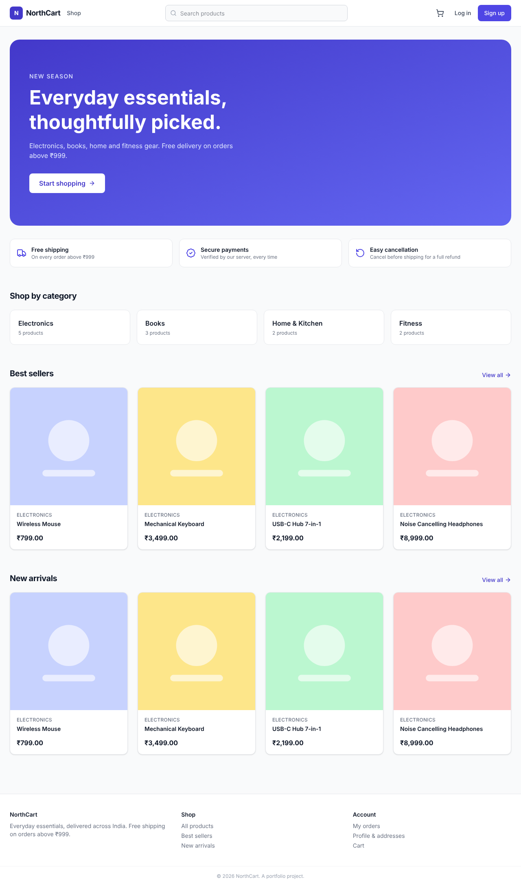
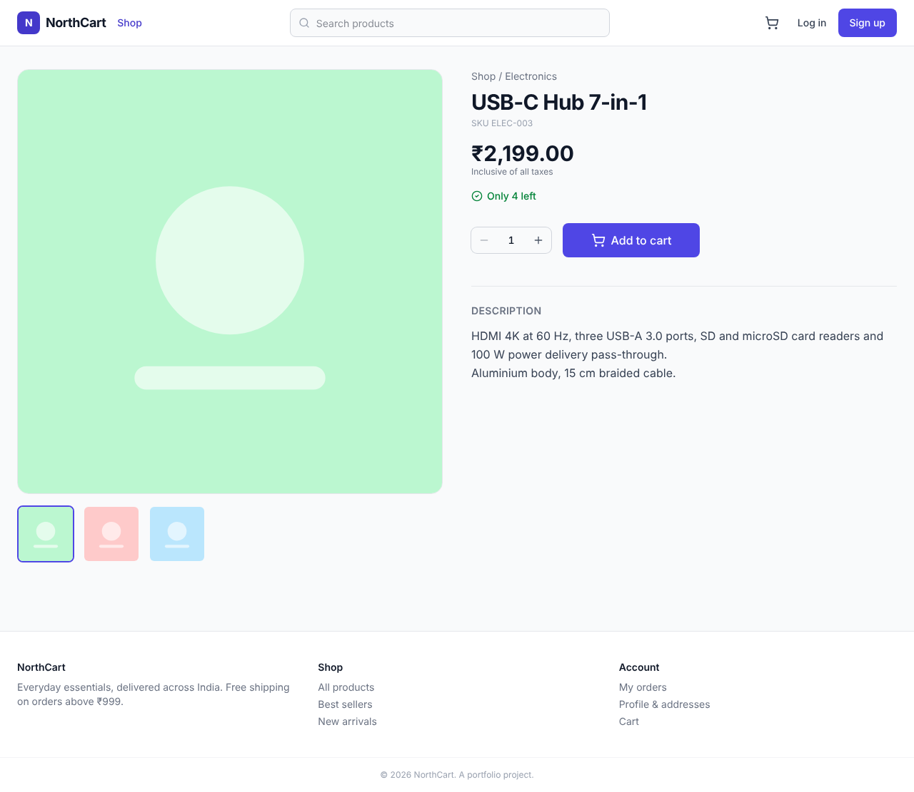
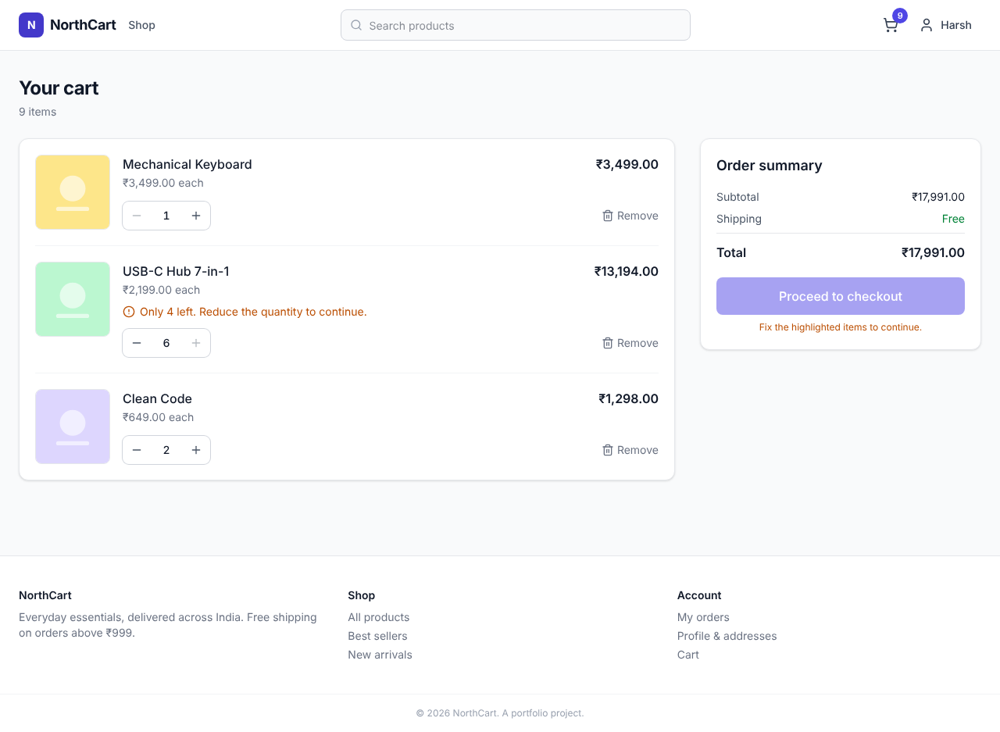
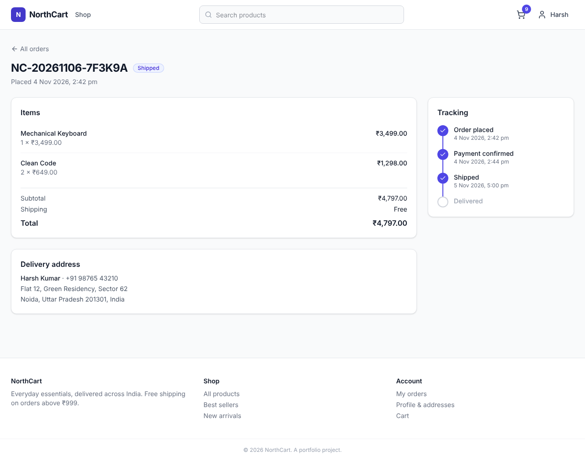
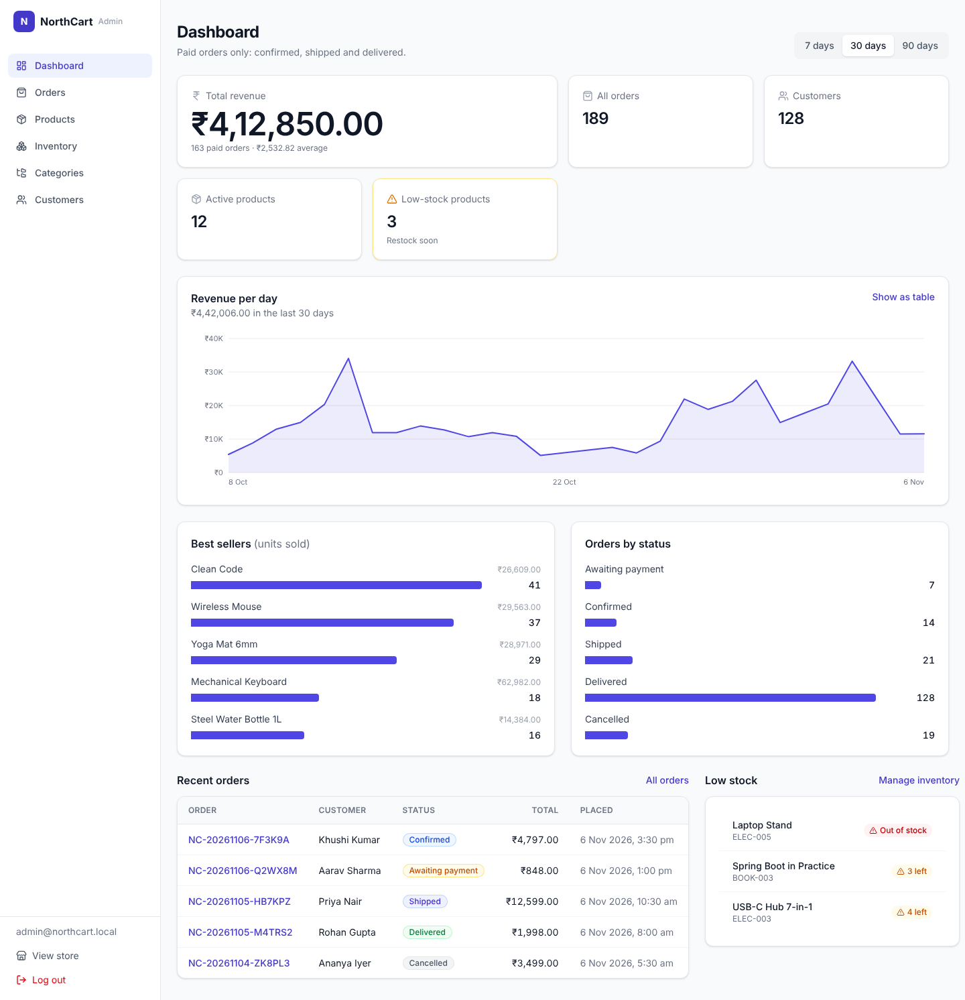
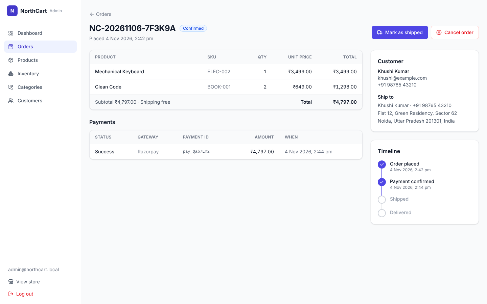
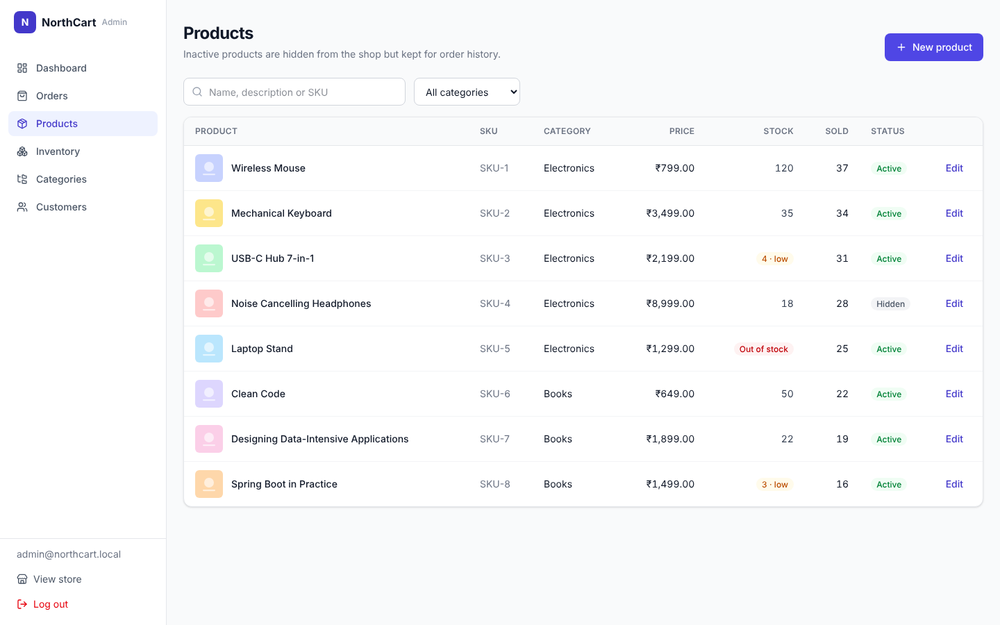
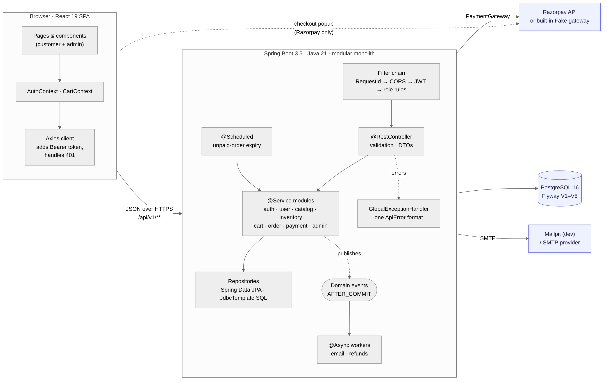

# NorthCart

A full-stack e-commerce platform: a storefront for customers and an operations console for admins.
Built with **Java 21 · Spring Boot 3.5 · PostgreSQL 16 · React 19**.



## Highlights

- **Shopping flow**: catalogue with full-text prefix search ("keyb" finds keyboards), filters, sorting,
  a cart with live stock warnings, checkout, payment, order tracking and cancellation.
- **Correct under concurrency**: stock can't be oversold (atomic conditional update plus a DB constraint,
  proven by a parallel-checkout test). A double-clicked checkout places one order (idempotency key).
  Unpaid orders expire and release their stock (`SKIP LOCKED` job).
- **Payments done safely**: Razorpay integration with server-side HMAC-SHA256 signature verification.
  The browser can never mark an order as paid. Late payments are refunded automatically. A built-in
  **fake gateway** runs the whole flow with no account.
- **Security**: JWT (stateless), BCrypt, role-based access. Disabling an account locks it out on the next request.
  Password reset uses hashed single-use tokens. No secrets in the frontend.
- **Admin console**: revenue dashboard (IST business days), order management with a status state machine,
  products, stock adjustments, categories, customers.
- **Operable**: one JSON error format with stable codes, a request id in every response and log line,
  transactional emails sent after commit, Flyway migrations, and OpenAPI docs.
- **Tested**: about 140 backend tests against a real PostgreSQL (Testcontainers), 31 frontend tests,
  an end-to-end smoke script and a Postman collection.

| | |
|---|---|
|  |  |
|  |  |
|  |  |

More in [`docs/screenshots`](docs/screenshots), including mobile.

## Architecture



A **modular monolith**: one deployable, with feature modules (`auth`, `catalog`, `inventory`, `cart`,
`order`, `payment`, `admin`, …) that talk to each other only through services.
[Architecture notes →](docs/architecture.md)

| Layer | Technologies |
|---|---|
| Backend | Java 21, Spring Boot 3.5, Spring Security, Spring Data JPA (Hibernate), Bean Validation, Flyway, jjwt, Thymeleaf (emails), springdoc-openapi, Lombok |
| Database | PostgreSQL 16 (full-text search, partial indexes, CHECK constraints) |
| Frontend | React 19, Vite 7, React Router 7, Tailwind CSS 4, Axios, Context API, react-hot-toast, lucide-react |
| Testing | JUnit 5, Mockito, Testcontainers, MockMvc, Vitest, React Testing Library |
| Tooling | Maven, Docker (multi-stage images, Compose), nginx, GitHub Actions CI, Mailpit (local SMTP), Postman |

## Run it locally

**Prerequisites:** JDK 21, Maven 3.9+, Docker Desktop (running), Node.js 20+.

```bash
cp .env.example .env            # defaults work as-is for local development
docker compose up -d            # PostgreSQL :5432 + Mailpit :8025

cd backend
mvn spring-boot:run             # API → http://localhost:8080   (wait for "Started NorthCartApplication")

# second terminal
cd frontend
npm install
npm run dev                     # app → http://localhost:5173
```

| URL | What |
|---|---|
| http://localhost:5173 | Storefront. Sign up, or browse the 12 sample products. |
| http://localhost:5173/admin/login | Admin console: `admin@northcart.local` / `Admin12345` (dev profile only) |
| http://localhost:8080/swagger-ui.html | Interactive API docs |
| http://localhost:8025 | Mailpit: every email the app sends lands here |
| http://localhost:8080/actuator/health | Health (database + mail) |

Payment uses the **fake gateway** by default: at checkout, click "Pay" in the simulated popup.
To use Razorpay test mode, see [Payments](#payments).

### Or: everything in Docker

The production images (backend on a JRE, frontend on nginx), with no Java or Node needed on the machine:

```bash
echo "JWT_SECRET=$(openssl rand -base64 32)" >> .env      # required by the prod profile
echo "ADMIN_EMAIL=admin@northcart.local" >> .env
echo "ADMIN_PASSWORD=ChangeMe-123" >> .env
docker compose --profile app up -d --build                # → http://localhost:3000
```

It shares the database with local development. If the dev backend already created `admin@northcart.local`,
that account keeps its password (`Admin12345`): the admin bootstrap never overwrites an existing user.
Details, and how to put it on a real server with HTTPS: [Deployment](docs/deployment.md).

### First-run checklist

1. `java -version` → 21, `mvn -v` → "Java version: 21", `docker info` works, `node -v` → 20+.
2. `docker compose ps` → `northcart-postgres` is **healthy**.
3. Start the backend. The log shows Flyway applying **V1–V5**, then `Started NorthCartApplication`.
4. http://localhost:8080/actuator/health → `{"status":"UP"}`.
5. `node scripts/smoke-test.mjs` → **ALL 28 STEPS PASSED**. The whole backend works end to end.
6. Start the frontend, open http://localhost:5173 and buy something. Check the emails in Mailpit.
7. Log in as admin, ship and deliver the order, then watch the customer's order timeline update.
8. `cd backend && mvn test` and `cd frontend && npm test`. Both are green.

Something off? → [Troubleshooting](docs/troubleshooting.md)

## Testing

```bash
cd backend  && mvn test            # unit + integration tests (needs Docker: real PostgreSQL via Testcontainers)
cd frontend && npm test            # Vitest + React Testing Library
node scripts/smoke-test.mjs        # end-to-end journey against the running backend (BASE_URL=... to target another)
```

- **Integration tests** use the full Spring context and MockMvc against a real PostgreSQL. They cover auth,
  catalog search, parallel checkouts racing for the last units, parallel cart updates, checkout idempotency, payment signatures,
  refunds, order expiry and admin flows.
- **Repository slice tests** (`@DataJpaTest`) pin the SQL: search, atomic stock updates, and dashboard day boundaries in IST.
- **Smoke test**: 28 steps over HTTP: register → browse → cart → checkout → forged signature rejected →
  pay → ship → deliver → cancel and stock restore.
- **Postman**: import `postman/NorthCart.postman_collection.json` and the `NorthCart.local` environment, then
  *Run collection*. The 46 requests chain tokens and ids automatically.

## Payments

`PAYMENT_PROVIDER=fake` (the default) runs the real checkout with a built-in gateway that signs
payments exactly like Razorpay, so the verification code is the same code path.

For **Razorpay test mode**:

1. Create test API keys at dashboard.razorpay.com → Test Mode → API Keys.
2. Put them in `.env`:
   ```
   PAYMENT_PROVIDER=razorpay
   RAZORPAY_KEY_ID=rzp_test_...
   RAZORPAY_KEY_SECRET=...
   ```
3. Restart the backend.

The key **secret** never leaves the server; the browser only gets the public key id.

## Configuration

All settings come from environment variables (or `.env`). See [`.env.example`](.env.example).
The important ones:

| Variable | Default (dev) | Notes |
|---|---|---|
| `DB_URL`, `DB_USERNAME`, `DB_PASSWORD` | local Docker DB | |
| `JWT_SECRET` | dev-only key | **Required** outside dev: `openssl rand -base64 32` |
| `ADMIN_EMAIL`, `ADMIN_PASSWORD` | `admin@northcart.local` / `Admin12345` | Bootstrap admin, created if missing |
| `PAYMENT_PROVIDER` | `fake` | `razorpay` for real test-mode payments |
| `CORS_ALLOWED_ORIGINS` | `http://localhost:5173` | Exact origins, comma-separated |
| `MAIL_HOST`, `MAIL_PORT` | Mailpit `localhost:1025` | |

Business rules live in `application.yml` under `app.*`: shipping is ₹49, free from ₹999. Unpaid orders expire after 30 minutes.

## Project structure

```
northcart/
├── backend/                      Spring Boot API
│   └── src/main/java/com/northcart/
│       ├── auth/ user/ address/      accounts, JWT login, password reset, profile
│       ├── catalog/ inventory/       products, categories, search, stock
│       ├── cart/ order/ payment/     cart, checkout, order lifecycle, gateway
│       ├── admin/ notification/      dashboard and back office, emails
│       ├── jobs/                     scheduled order expiry
│       └── common/ config/ security/ errors, request ids, settings, filters
│   └── src/main/resources/db/migration/   Flyway V1–V5      (+ Dockerfile)
├── frontend/                     React app (pages, components, contexts, hooks, api/), Dockerfile + nginx.conf
├── docs/                         architecture, API, database, performance, troubleshooting
├── postman/                      collection + local environment
├── scripts/                      smoke test, Postman generator, perf dataset + EXPLAIN scripts
├── .github/workflows/ci.yml      tests + image builds on every push
├── docker-compose.yml            PostgreSQL + Mailpit; --profile app adds backend + frontend
└── .env.example
```

## Documentation

- [Architecture](docs/architecture.md): modules, request lifecycle, checkout sequence, frontend design
- [API reference](docs/api.md): conventions, error codes, every endpoint, order lifecycle
- [Database](docs/database.md): ER diagram, constraints, migrations
- [Performance](docs/performance.md): EXPLAIN ANALYZE at 50k products / 200k orders, and what was changed
- [Deployment](docs/deployment.md): Docker images, running on a server, production checklist, operations, CI
- [Troubleshooting](docs/troubleshooting.md)
- [Interview prep](docs/interview-prep.md): 110 questions with answers, and a 2–3 minute project pitch
