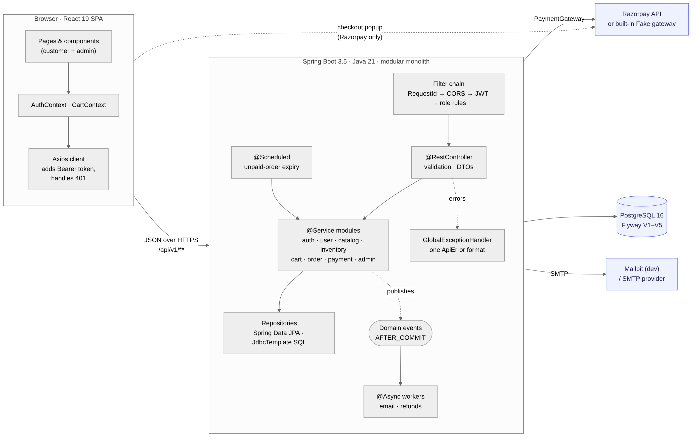
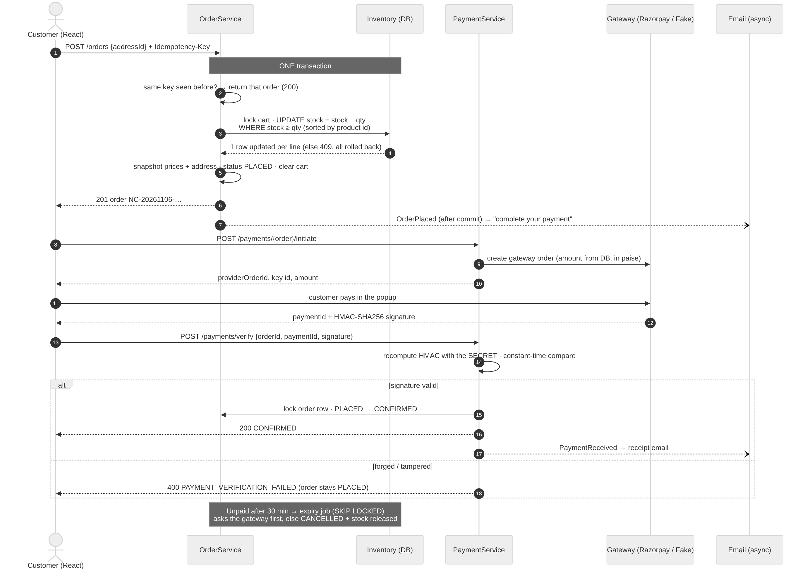

# Architecture

Source: [`diagrams/architecture.mmd`](diagrams/architecture.mmd) (GitHub renders Mermaid; the PNG is for everywhere else).

## Shape: a modular monolith

NorthCart is **one Spring Boot application with one database**, split internally into feature
modules: `auth`, `user`, `address`, `catalog`, `inventory`, `cart`, `order`, `payment`,
`notification`, `admin`, plus the shared `common`, `config` and `security`.

Why not microservices?

- Checkout must reserve stock, create the order and clear the cart **atomically**. In one database that
  is one transaction. Across services it becomes a saga, with compensations and eventual consistency.
- Microservices only pay off with many teams who need to deploy independently. Here they would only add network failure modes.
- The module boundaries are real, so splitting later stays possible. Each module talks to the
  others through its `@Service` (e.g. `OrderService` calls `InventoryService.reserve`), never
  through another module's repository.

## Request lifecycle

1. **`RequestIdFilter`** (first filter) gives every request an id. It goes into the MDC, so every log line
   carries it, and into the `X-Request-Id` response header.
2. **CORS**: only the configured frontend origin may call from a browser.
3. **`JwtAuthenticationFilter`** validates the token (signature, expiry, issuer), then **re-loads the user** from
   the database. A disabled account is therefore locked out on its very next request, not when its
   token expires.
4. **Authorization rules** in `SecurityConfig`, by URL and role.
5. **Controller** deserialises and validates the DTO (`@Valid`). Unknown JSON fields are rejected.
6. **Service** runs the business logic in a `@Transactional` method.
7. **Repository** queries: Spring Data JPA for CRUD, plain SQL (`NamedParameterJdbcTemplate`)
   for full-text search and reports.
8. Any exception is turned into the single `ApiError` JSON by `GlobalExceptionHandler`.

## Checkout and payment

The rules that make it safe:

| Risk | Guard |
|---|---|
| Two buyers, one item left | Stock is decremented with one conditional `UPDATE … WHERE quantity_available >= :qty`. The database serialises it, and a CHECK constraint forbids negative stock. Tested with concurrent threads. |
| Deadlocks between two carts | Products are always reserved in ascending id order. |
| Double-click on "Place order" | `Idempotency-Key` header plus a unique `(user_id, idempotency_key)` constraint. |
| Price changes after ordering | Price, name, SKU and the address are **copied** into the order. |
| Faked "payment successful" | The browser never says "paid". The server recomputes the HMAC-SHA256 signature with the secret, and only then marks the order CONFIRMED. |
| Pay twice / pay late | A partial unique index allows one SUCCESS payment per order. A payment for an expired order is recorded and refunded. |
| Abandoned checkouts holding stock | The expiry job cancels unpaid orders after 30 min (`FOR UPDATE SKIP LOCKED`, safe with several app instances), after asking the gateway whether a payment is in flight. |
| An email failure undoing an order | Emails are sent by `@Async` listeners **after commit**. A slow or failing SMTP server never affects the order. |

## Frontend

- **Routing**: React Router 7 with lazy-loaded pages. `ProtectedRoute` checks the login and role.
  Admin pages have their own layout under `/admin`.
- **State**:
  - `AuthContext`: the user and the token (in `localStorage`).
  - `CartContext`: the cart count in the navbar.
  - Everything else is fetched per page with `useAsync`, which ignores stale responses.
  - Filters live in the **URL**, so they survive a refresh and can be shared as links.
- **API layer**: one Axios instance (`api/client.js`) adds the token and turns a 401 into "log out
  and go to login". All endpoints are in `api/endpoints.js`, so pages never build URLs.
- **Dev proxy**: Vite forwards `/api` to `:8080`. The browser sees one origin, so local
  development needs no CORS.

## Data

See [database.md](database.md) for the ER diagram and the rules enforced by constraints, and
[performance.md](performance.md) for how the hot queries behave at 200k orders.
