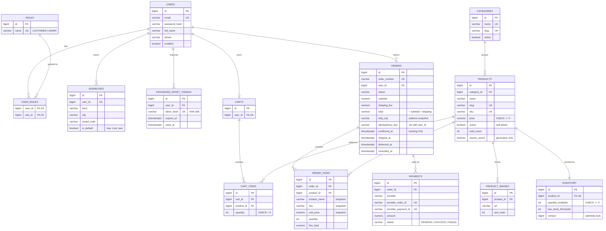

# NorthCart – Database Design

PostgreSQL schema managed by Flyway (`backend/src/main/resources/db/migration`).
14 tables, all with surrogate `BIGINT` identity keys and `created_at` / `updated_at` audit columns.

## Relationships

| Relationship | Type | Enforced by | On delete |
|---|---|---|---|
| users ↔ roles | Many-to-many | `user_roles` composite PK | cascade from user |
| users → addresses | One-to-many | `fk_addresses_user` | cascade |
| users → password_reset_tokens | One-to-many | `fk_password_reset_tokens_user` | cascade |
| users → carts | One-to-one | `uk_carts_user` | cascade |
| carts → cart_items | One-to-many | `fk_cart_items_cart`, `uk_cart_items_cart_product` | cascade |
| categories → products | One-to-many | `fk_products_category` | **restrict** |
| products → product_images | One-to-many | `fk_product_images_product` | cascade |
| products → inventory | One-to-one | `uk_inventory_product` | cascade |
| users → orders | One-to-many | `fk_orders_user` | **restrict** (keep history) |
| orders → order_items | One-to-many | `fk_order_items_order` | cascade |
| products → order_items | One-to-many | `fk_order_items_product` | **restrict** |
| orders → payments | One-to-many (retries) | `fk_payments_order` | **restrict** |

## Migrations

| Version | Change |
|---|---|
| V1 | Initial schema (14 tables) |
| V2 | Seed roles |
| V3 | Order status timestamps (`confirmed_at`, `shipped_at`, `delivered_at`) + `cancelled_at` consistency check |
| V4 | Payment refunds (`provider_refund_id`, `refunded_at`), FAKE provider, REFUNDED status, at most one successful payment per order (partial unique index) |
| V5 | Performance: `ck_products_sku_uppercase` (lets search use `uk_products_sku`) and partial index `ix_orders_paid_confirmed_at` for the dashboard. See [performance.md](performance.md) |

## Snapshot rule

`order_items` stores `product_name`, `sku` and `unit_price`, and `orders` stores the `ship_*` address
columns, copied at checkout. Editing a product or an address never changes a past order.

## Integrity rules enforced by the database

- Stock can never go negative (`ck_inventory_quantity_non_negative`).
- One default address per user (partial unique index `ux_addresses_one_default_per_user`).
- `orders.total = subtotal + shipping_fee`; `order_items.line_total = unit_price * quantity`.
- A payment can only be `SUCCESS` with a gateway payment id and `paid_at`.
- The same gateway payment id can never be recorded twice.
- The same checkout request (idempotency key) can never create two orders.

## Indexes

| Index | Serves |
|---|---|
| `ix_products_search` (GIN on `search_vector`) | Full-text product search |
| `ix_products_category_id`, `ix_products_price` | Category and price filters |
| `ix_products_created_at`, `ix_products_sold_count` | Sort by newest / popularity |
| `ix_orders_user_created_at` | "My orders", newest first |
| `ix_orders_status_created_at` | Admin status filter, unpaid-order expiry job |
| `ix_order_items_product_id` | Best-seller report |
| `ix_inventory_quantity_available` | Low-stock alerts |
| `ix_payments_order_id` | Payments of an order |
